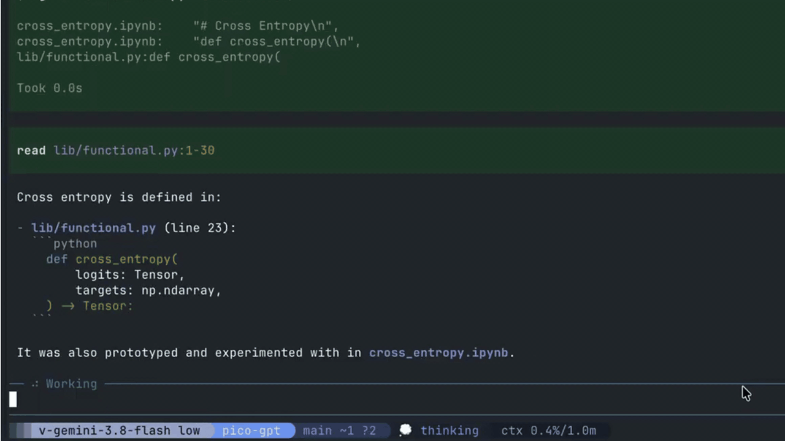

# pi-typst

[](https://github.com/iharuya/pi-typst/actions/workflows/checks.yml)
[](https://www.npmjs.com/package/pi-typst)
[](https://github.com/iharuya/pi-typst/blob/main/LICENSE)



A Pi extension that renders Typst markup into terminal images.

## Install

```sh
pi install npm:pi-typst
```

## Prerequisites

Requires the [Typst CLI](https://typst.app/open-source/) to be installed and available on your system.

> [!WARNING]
> The default terminals on macOS (Terminal.app) and Ubuntu (GNOME Terminal / Ptyxis) are not supported.

Rendered output is displayed as an inline image, so you need a terminal that supports one of the following:
- [Kitty graphics protocol](https://sw.kovidgoyal.net/kitty/graphics-protocol/): [Kitty](https://sw.kovidgoyal.net/kitty/), [Ghostty](https://ghostty.org/), [WezTerm](https://wezterm.org/), [Warp](https://www.warp.dev/)
- [iTerm2 inline images](https://iterm2.com/documentation-images.html): [iTerm2](https://iterm2.com/)

### Terminal multiplexers

Pi turns off inline images inside terminal multiplexers such as tmux and [Herdr](https://herdr.dev/), so the `typst` tool fails there by default.

Herdr 0.9 and later render Kitty graphics when the outer terminal supports them. To enable images in Herdr, set [`PI_IMAGE_PROTOCOL`](https://github.com/earendil-works/pi/blob/main/packages/coding-agent/docs/terminal-setup.md#override-detected-capabilities) before starting Pi:

```sh
export PI_IMAGE_PROTOCOL=kitty
```

Alternatively, set `terminal.images` to `"kitty"` in Pi's settings.

pi-typst shows a warning at startup inside Herdr 0.9 and later while images are off.

